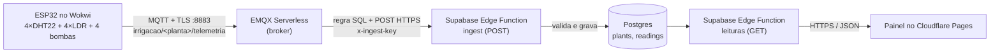

# Irrigação, mas com um diferencial

Sistema IoT de **irrigação inteligente com previsão** para 4 plantações (alface, morango, tomate e manjericão).
Em vez de ligar a bomba só quando a umidade do solo cai abaixo de um limite, o ESP32 ajusta uma regressão linear
nas últimas leituras e liga a bomba **antes** de o solo secar. O painel mostra a curva real contra a prevista,
os acionamentos da bomba e a água gasta.

**Integrantes:** Matheus Correa (RA 2037959), Gabriel Tomazela (RA 2028807), Pedro Servidoni (RA 2039519)

| O quê | Link |
|---|---|
| Painel publicado (Cloudflare Pages) | https://irrigacao-inteligente.pages.dev |
| Simulação (Wokwi, ESP32) | https://wokwi.com/projects/481580944183992321 |
| API de consulta (GET) | https://stfpruxggcextsaulvqi.supabase.co/functions/v1/leituras |
| Vídeo de demonstração | _(adicionar o link do YouTube não listado)_ |

## Arquitetura (Opção A, com MQTT)



1. **ESP32 (Wokwi)** lê, a cada 2 s, a temperatura (DHT22, protocolo de 1 fio) e a luz (LDR, conversor analógico-digital de 12 bits)
   de cada plantação, converte a tensão do LDR em lux, atualiza a umidade do solo (modelo físico simulado) e decide a bomba.
   A cada 5 s publica uma mensagem JSON por plantação.
2. **EMQX** recebe as mensagens por MQTT com TLS, confere usuário e permissões (o ESP32 só pode publicar em `irrigacao/#`)
   e, por uma regra SQL, repassa cada mensagem por HTTPS para a função `ingest`.
3. **Função `ingest`** (API REST, `POST /functions/v1/ingest`) confere o segredo `x-ingest-key`, valida o contrato
   (dispositivo, plantação, faixas físicas) e grava em `readings`. Mensagens repetidas são ignoradas (chave `plant_id + message_id`).
4. **Função `leituras`** (API REST, `GET /functions/v1/leituras`) devolve, para cada plantação, a faixa ideal,
   a **leitura mais recente**, o **histórico** e a água total, com as unidades.
5. **Painel** consulta a API a cada 5 s, mostra valores atuais com unidade, horário da última atualização, histórico,
   alertas de faixa e avisa quando os dados ficam desatualizados.

## Estrutura do repositório

```
README.md
.env.example              nomes dos segredos (sem valores)
wokwi/                    firmware MicroPython e circuito
  main.py                 sensores, modelo do solo, regressão, bombas, MQTT
  config.py               host/usuário MQTT (senha NÃO versionada)
  ca_cert.py              CA pública do broker (DigiCert Global Root CA)
  mqtt_client.py          cliente MQTT (umqtt.simple, licença MIT)
  diagram.json            circuito do Wokwi
supabase/
  schema.sql              estrutura do banco (tabelas, segurança, view)
  migrations/             mudanças aplicadas depois
  functions/ingest/       API de recebimento (POST)
  functions/leituras/     API de consulta (GET)
emqx/                     regra SQL e configuração do broker (sem senhas)
site/                     painel (index.html + config.js com valores públicos)
```

## Estrutura do banco

| Tabela | Campos principais |
|---|---|
| `plants` | `id`, `nome`, `umidade_min/max` (%), `temp_min/max` (°C), `luz_min/max` (lux), `vazao_ml_s` |
| `readings` | `device_id`, `plant_id`, `message_id`, `soil_moisture` (%), `temperature` (°C), `light_lux` (lux), `pump_on`, `pump_reason` (`limite` ou `previsao`), `water_ml`, `predicted_dry_s`, `received_at` |
| `resumo_agua` (view) | água total e número de leituras por plantação |

Segurança: RLS ativo. O público só pode **ler**; somente a função `ingest`, com a chave de servidor, grava.

## API

**Envio (usado pelo EMQX)**
```
POST /functions/v1/ingest
Content-Type: application/json
x-ingest-key: <INGEST_KEY>

{"topic":"irrigacao/alface/telemetria",
 "reading":{"device_id":"irrig01","plant_id":"alface","message_id":"alface-ab12cd34-7",
            "soil_moisture":66.4,"temperature":20.0,"light_lux":15067.8,
            "pump_on":false,"pump_reason":null,"water_ml":0,"predicted_dry_s":52.3}}
```
Respostas: `201` gravado, `200` repetido, `400` contrato inválido, `401` segredo errado.

**Consulta (usada pelo painel)**
```
GET /functions/v1/leituras                 todas as plantações, última hora
GET /functions/v1/leituras?planta=tomate   uma plantação
GET /functions/v1/leituras?minutos=15      janela do histórico (1 a 1440)
```

## Como reproduzir

1. **Supabase:** crie um projeto e rode `supabase/schema.sql` no SQL Editor. Em *Edge Functions > Secrets*, crie
   `INGEST_KEY` (32+ caracteres). Publique `functions/ingest` e `functions/leituras` e **desligue “Verify JWT”** nas duas.
2. **EMQX:** crie um deployment Serverless e configure como em [`emqx/configuracao.md`](emqx/configuracao.md).
3. **Wokwi:** crie um projeto ESP32 MicroPython com os arquivos de `wokwi/`. Em `config.py`, troque `MQTT_HOST` pelo seu
   broker e `COLE_A_SENHA_MQTT` pela senha **só na hora de rodar, sem salvar**.
4. **Cloudflare Pages:** em `site/config.js`, ajuste `apiUrl` para a URL da sua função `leituras` e publique a pasta `site`
   com *Upload assets*.
5. Inicie a simulação e abra o painel.

## Testes realizados

| Teste | Como | Resultado esperado |
|---|---|---|
| Fluxo completo | mudar a temperatura de um DHT22 no Wokwi | o valor novo aparece na API e no painel em até ~10 s |
| Alerta | levar a temperatura ou a luz para fora da faixa ideal | faixa de alerta no topo do painel |
| Previsão | deixar o solo secar | a bomba liga com motivo **previsão** antes do mínimo |
| Interrupção e retomada | enviar `x` + Enter no Serial Monitor (duas vezes) | o painel mostra “Dados desatualizados” e depois volta sozinho |
| Painel fechado | fechar o painel por alguns minutos e consultar a API | as leituras do período estão gravadas |
| Segurança | enviar sem `x-ingest-key` | `401` e nada gravado |

## Limitações

- A umidade do solo é **simulada** por um modelo físico (o Wokwi não tem sensor de solo que reaja à bomba);
  temperatura e luz vêm de sensores simulados reais do Wokwi.
- O Wokwi desacelera quando a aba fica em segundo plano: a simulação precisa ficar visível.
- O plano gratuito do EMQX permite um broker Serverless por conta; o projeto usa usuário, tópicos, conector e regra próprios.
- A regressão do painel só estima o efeito de temperatura e luz quando esses valores variam.

## Contribuições

Os commits deste repositório foram feitos por Gabriel Tomazela em nome do grupo; a divisão do trabalho foi:

| Integrante | Parte |
|---|---|
| Matheus Correa | firmware do ESP32 e circuito no Wokwi (`wokwi/`) |
| Gabriel Tomazela | banco e APIs no Supabase, broker EMQX (`supabase/`, `emqx/`) |
| Pedro Servidoni | painel no Cloudflare Pages (`site/`) e documentação |
